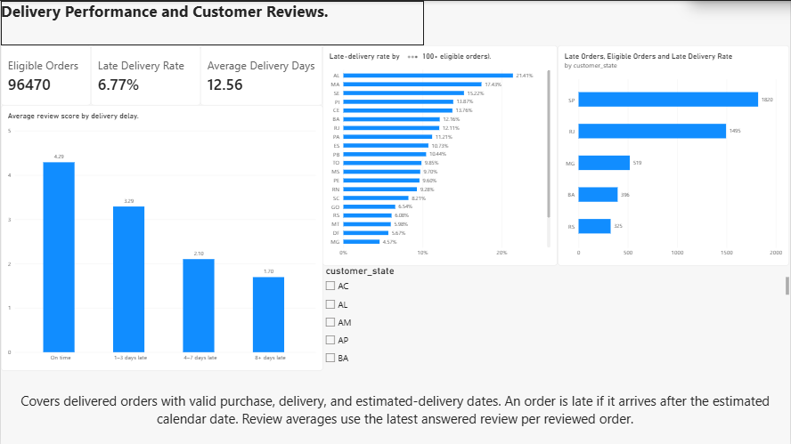

# Olist Delivery Performance and Customer Reviews

A MySQL and Power BI project exploring how delivery delays
relate to customer review scores and where late deliveries
are concentrated.

## Key findings

- Of 96,470 eligible delivered orders, 6,534 arrived late
  (6.77%). Average delivery time was 12.56 days.
- Average review scores fell from 4.29/5 for on-time orders
  to 1.70/5 for orders that arrived 8 or more days late.
- SP had the most late orders (1,820). AL had the highest
  late-delivery rate among states with at least 100 eligible
  orders (21.41%). RJ combined a high rate (12.11%) with
  1,495 late orders, making it a priority for investigation.

## SQL and validation

I staged the CSVs, converted timestamps, checked date
sequences, and defined one row per eligible delivered order.
I used ROW_NUMBER() to select the latest answered review
per order and verified that joins preserved order counts.
After investigating a query timeout with EXPLAIN, I indexed
the customer key and stored the selected reviews in an
indexed table.

Power BI matched SQL on eligible orders (96,470), late
orders (6,534), and orders with reviews (95,824).

## Definitions

An order is late if it arrives after the estimated calendar
date. Review averages exclude orders with no score. The
state rate comparison requires at least 100 eligible orders.
The review comparisons describe an association.

## Project files

- [Dashboard preview](reports/olist_delivery_overview.png)
- [Report PDF](reports/Olist_Delivery_Portfolio.pdf)
- [SQL scripts](sql/)

## Data source

[Olist Brazilian E-Commerce Public Dataset](https://www.kaggle.com/datasets/olistbr/brazilian-ecommerce)
- [Instructions to rebuild the analysis](docs/REPRODUCE.md)